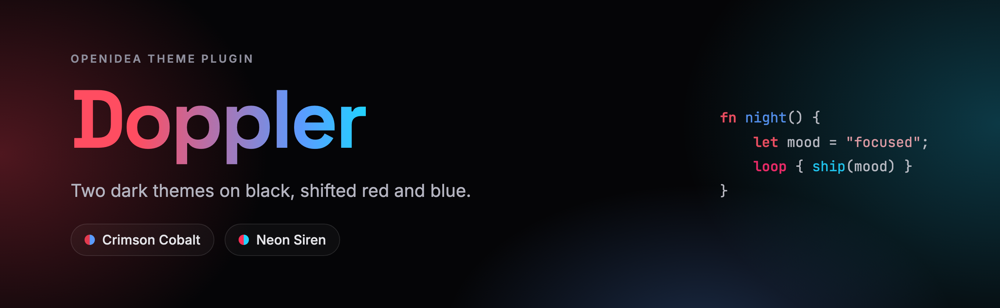
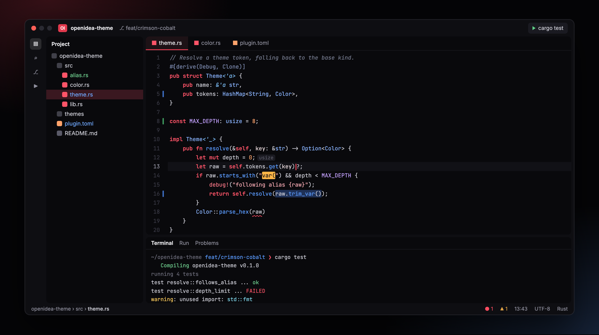
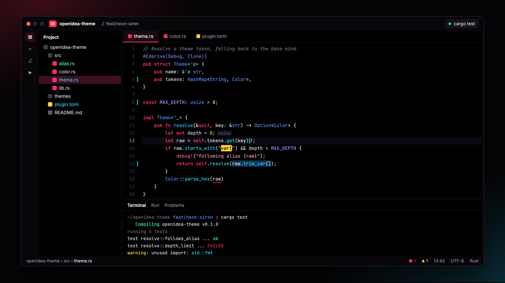

<p align="center">
  
</p>

<p align="center">
  &nbsp;
  <b>Doppler</b> for <a href="https://github.com/l0ng-ai/openidea">OpenIDEA</a>
  &nbsp;·&nbsp; <a href="#install">Install</a>
  &nbsp;·&nbsp; <a href="#crimson-cobalt">Crimson Cobalt</a>
  &nbsp;·&nbsp; <a href="#neon-siren">Neon Siren</a>
</p>

Two dark themes built on black, shifted red and blue, like light under the Doppler effect. Each one themes the
whole IDE: surfaces, tabs, tool windows, selection, Git and diff colours, syntax
for every language, and the terminal's ANSI palette.

The plugin is data only: no code, no WebAssembly and no permissions.

---

## Crimson Cobalt

The balanced one. Near-black surfaces, a crimson accent for the UI and
keywords, and electric blue for functions and types. It works for long days.



| Role | Colour |
| --- | --- |
| Editor background | `#09090c` |
| Accent | `#e23a4e` |
| Keywords | `#ff5468` |
| Functions | `#5b9bff` |
| Types | `#8ab4ff` |
| Strings | `#f2a7b0` |
| Numbers | `#ffa36b` |
| Caret | `#ff4d61` |

## Neon Siren

The loud one. Pure black, a hot red-pink and a cyan-blue at full saturation,
with a cyan caret. It suits night sessions and screenshots.



| Role | Colour |
| --- | --- |
| Editor background | `#000000` |
| Accent | `#ff2d55` |
| Keywords | `#ff2d6f` |
| Functions | `#22d3ff` |
| Types | `#4f8cff` |
| Strings | `#ff8fb4` |
| Numbers | `#ffd23f` |
| Caret | `#22d3ff` |

---

## Install

**From the marketplace:** open **Settings › Plugins › Marketplace**, search for
*Doppler*, and click **Install**.

**From a release:** download the `.oiplugin` file from the
[latest release](https://github.com/Rhombicdodecahedron/openidea-doppler/releases/latest).
In **Settings › Plugins**, open the gear menu, choose **Install Plugin from
Package File…** and pick the file.

**From source:** clone this repository. In **Settings › Plugins**, open the gear
menu, choose **Install Plugin from Disk…** and pick the folder.

Then select the plugin and press **Apply** next to *Crimson Cobalt* or *Neon
Siren*. Both themes are also listed under **Settings › Appearance & Behavior ›
Appearance › Theme**. To switch back, use **Use Default Theme**.

An accent colour you pick in Appearance, or overrides you set in **Editor ›
Colour Scheme**, still apply on top of the theme.

## What's in the package

```text
plugin.toml                       manifest: id, version, the two themes, icon
icon.svg                          marketplace icon
themes/
├─ crimson-cobalt.theme.json      UI colours (surfaces, text, accent, tabs, Git…)
├─ crimson-cobalt.scheme.json     editor colours (syntax, editor, ANSI)
├─ neon-siren.theme.json
└─ neon-siren.scheme.json
```

Every token the OpenIDEA theme format exposes is set, so nothing falls back to
the built-in Islands Dark colours. Body text and all syntax colours meet WCAG AA
contrast (4.5:1) on the editor background.

## Tweak a colour

The theme files are commented JSON. Each key is an OpenIDEA CSS variable, such
as `--accent`, `--syn-keyword` or `--caret`. Delete a line to keep the built-in
value. To iterate, link the folder with `openidea-plugin link` and press
**Reload** on the plugin after each edit.

## Licence

[MIT](https://github.com/Rhombicdodecahedron/openidea-doppler/blob/main/LICENSE). The file layout follows OpenIDEA's Harbor Night template
(Apache-2.0).
